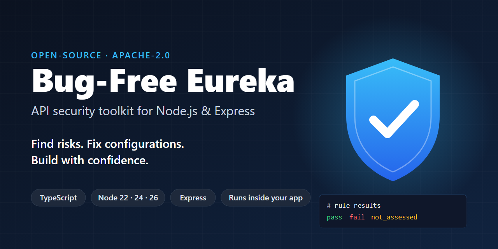

<p align="center">
  
</p>

[](https://github.com/bitsaspidy/bug-free-eureka/actions/workflows/ci.yml)

# Bug-Free Eureka

**Find risks. Fix configurations. Build with confidence.**

Bug-Free Eureka is an open-source API security toolkit for Node.js and Express. It detects common security misconfigurations, audits API configuration and helps keep sensitive data out of your logs, and it runs inside your existing app.

> **Status: early development.** Nothing is published to npm yet, and the APIs below may change. See [Roadmap](#roadmap) and the [work-order board](docs/WORK_ORDERS.md).

**Documentation:** [bitsaspidy.github.io/bug-free-eureka](https://bitsaspidy.github.io/bug-free-eureka/): quickstart, CLI and Express reference, rules, configuration, limitations and deployment guide. The site goes live after the first deploy from `main`; until then, read the same pages in [docs/](docs/).

Read the announcement: [Introducing Bug-Free Eureka](https://satsaiinfo.com/blog/introducing-bug-free-eureka-an-open-source-api-security-toolkit-for-nodejs-and-express)

## Why Bug-Free Eureka

- **Runs inside your app.** No separate server, no port change, no route rewrites and no silent production changes.
- **No mandatory infrastructure.** No database, Redis, Docker, cloud account or API key is required.
- **Unknown is not a pass.** If a rule can't establish the facts (for example, how your reverse proxy is configured), it reports `not_assessed` instead of assuming you're fine.
- **Deterministic.** The same input always gives the same findings: no network, clock or randomness inside rule logic.
- **Never executes scanned code.** The static audit only reads and parses files, with size and path-traversal limits.
- **No secrets in output.** Reports, logs and errors never contain tokens, passwords, cookies or auth headers.

## Packages

| Package | What it does | Status |
|---|---|---|
| [`@bug-free-eureka/core`](packages/core) | Rule engine, rules, finding model, report builder and a deep redaction utility (`redact`). Framework-free. | In progress |
| [`@bug-free-eureka/cli`](packages/cli) | `init` and `audit` commands, text, JSON and SARIF output, `--fail-on` for CI. | Implemented (not yet on npm) |
| [`@bug-free-eureka/express`](packages/express) | Opt-in Express 4/5 middleware: sliding-window rate limiter (in-memory or Redis-compatible store) and a redacting audit logger. Hardening middleware is not built yet. | Implemented (not yet on npm) |

### Express quick start (not yet on npm)

Both middlewares are opt-in and change nothing else in your app. The limiter keys on `req.ip`, so set `trust proxy` to your real proxy hop count. See [packages/express](packages/express) for the Redis store and the store-outage behaviour.

```js
import { createAuditLogger, createRateLimiter } from "@bug-free-eureka/express";

app.set("trust proxy", 1); // exactly one reverse proxy in front of the app
app.use(createAuditLogger({ sink: (event) => console.log(JSON.stringify(event)) }));
app.use("/login", createRateLimiter({ limit: 5, windowMs: 60_000, onStoreError: "fail-closed" }));
```

### CLI quick start (not yet on npm)

Build from this repository, then run it in your project. It reads JSON config and evidence files only and never runs your code. A rule without evidence is reported as not assessed, which is not a pass. See [packages/cli](packages/cli) for the evidence files and exit codes.

```bash
node <path-to-repo>/packages/cli/dist/bin.js init
node <path-to-repo>/packages/cli/dist/bin.js audit --format sarif --output results.sarif --fail-on high
```

## Rules

| ID | Checks for | Default severity | Status |
|---|---|---|---|
| [BFE-001](docs/rules/BFE-001.md) | Missing recommended security headers | medium | Implemented |
| [BFE-003](docs/rules/BFE-003.md) | Missing request-size limit | medium | Implemented |
| [BFE-005](docs/rules/BFE-005.md) | Sensitive data in configured logging | high | Implemented |
| [BFE-006](docs/rules/BFE-006.md) | Unsafe trusted-proxy configuration | high | Implemented |
| BFE-002 | Unsafe CORS on sensitive endpoints | high | Planned (v0.3) |
| BFE-004 | Missing declared login rate-limit policy | high | Planned (v0.3) |
| BFE-007 | Stack traces in production error handling | medium | Planned (v0.3) |
| BFE-008 | Insecure session-cookie properties | high | Planned (v0.3) |

Every finding is `pass`, `fail` or `not_assessed`, with evidence and a suggested fix. Severities are defaults, not a judgment of your actual risk.

## Compatibility

Tested in CI on Node.js **22, 24 and 26** on Linux, Windows and macOS (`engines: ">=22 <27"`), with ESM and CommonJS builds. Every pull request runs lint, typecheck, tests with coverage and build across that full matrix.

## Develop locally

Requires Node.js 22 or newer and npm 11.

```bash
git clone https://github.com/bitsaspidy/bug-free-eureka.git
cd bug-free-eureka
npm ci
npm run build
npm test
```

TypeScript is pinned to `~6.0.0` because typescript-eslint 8.72.2 supports only `typescript <6.1`; Dependabot ignores newer TypeScript until that changes.

Other scripts: `npm run typecheck`, `npm run lint`, `npm run format:check`, `npm run test:coverage`, and `npm run docs:dev` / `npm run docs:build` for the documentation site.

## Roadmap

Planning dates; security beats schedule.

- **v0.1:** core engine and the first four rules (BFE-001, 003, 005, 006)
- **v0.2:** Express adapter
- **v0.3:** CLI and CI integration with JSON and SARIF reports
- **v0.4:** more rules and a public beta (January 2027)
- **v1.0:** stable release after review (February 2027)

## Work-order status

Updated with every work order. Full details are on the [work-order board](docs/WORK_ORDERS.md).

| WO | Work | Status |
|---|---|---|
| WO-000 | AI development team (agents, skills, dashboard) | ✅ Done ([#1](https://github.com/bitsaspidy/bug-free-eureka/pull/1)) |
| WO-001 | Repository foundation (workspaces, TypeScript, tooling, community files) | ✅ Done ([#3](https://github.com/bitsaspidy/bug-free-eureka/pull/3)) |
| WO-002 | Security rule engine and report builder | ✅ Done ([#7](https://github.com/bitsaspidy/bug-free-eureka/pull/7)) |
| WO-003 | BFE-001 security headers | ✅ Done ([#9](https://github.com/bitsaspidy/bug-free-eureka/pull/9)) |
| WO-004 | BFE-003 request limits, BFE-006 trusted proxy | ✅ Done ([#10](https://github.com/bitsaspidy/bug-free-eureka/pull/10)) |
| WO-005 | BFE-005 sensitive logging and redaction | ✅ Done ([#18](https://github.com/bitsaspidy/bug-free-eureka/pull/18), [#20](https://github.com/bitsaspidy/bug-free-eureka/pull/20)) |
| WO-006 | CLI: `init`, `audit`, JSON and SARIF output, exit codes | ✅ Done ([#22](https://github.com/bitsaspidy/bug-free-eureka/pull/22)) |
| WO-007 | Express adapter: rate limiter, redacting audit logger, Redis option | ✅ Done ([#25](https://github.com/bitsaspidy/bug-free-eureka/pull/25)) |
| WO-008 | Cross-platform CI, CodeQL, dependency review, Dependabot | ✅ Done ([#13](https://github.com/bitsaspidy/bug-free-eureka/pull/13)) |
| WO-009 | Documentation site (quickstart, config reference, deployment) | 🔍 In review ([#27](https://github.com/bitsaspidy/bug-free-eureka/pull/27)) |
| WO-010 | npm publishing (Changesets, provenance) | ⏳ To do |
| WO-011 | Sponsors and governance | ⏳ To do |
| WO-012 | External beta | ⏳ To do |
| WO-013 | Stable v1.0.0 | ⏳ To do |
| WO-014 | Post-launch improvement | ⏳ To do |

## What it is not

Bug-Free Eureka finds common, well-defined misconfigurations. It is not a penetration test, it can't prove that vulnerabilities are absent, and it doesn't make an app "secure" or "OWASP compliant" on its own.

## Contributing

Contributions are welcome. Read [CONTRIBUTING.md](CONTRIBUTING.md) and our [Code of Conduct](CODE_OF_CONDUCT.md), then use the issue templates to report a bug or propose a rule.

## Security

Please don't open public issues for vulnerabilities. [Report them privately](https://github.com/bitsaspidy/bug-free-eureka/security/advisories/new); see [SECURITY.md](SECURITY.md).

## License

Licensed under [Apache-2.0](LICENSE). Maintained by Devavrat Singh ([@bitsaspidy](https://github.com/bitsaspidy)).
